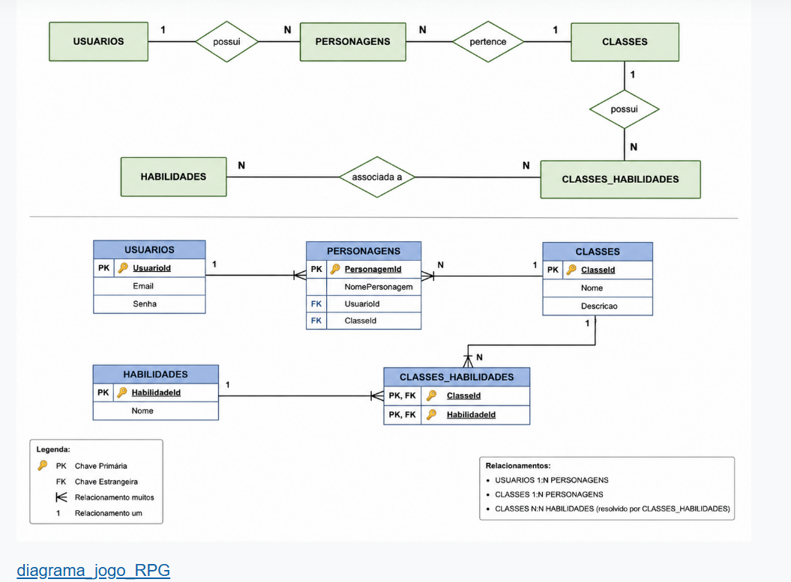
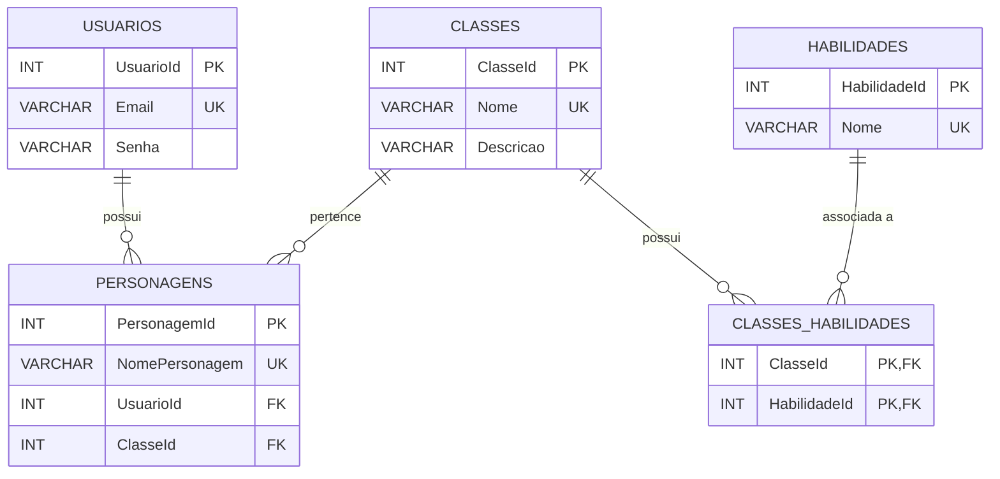

# 🎮 Banco de Dados — Jogo de RPG Online

Script SQL em **Linguagem de Definição de Dados (DDL)** que cria a estrutura do banco de dados de um jogo de RPG online, conforme o diagrama entidade-relacionamento da atividade.

> **Atividade de entrega:** Criar as tabelas para o projeto de jogo de RPG online, utilizando linguagem de definição de banco de dados.
> **Desafio relacionado:** Desafio 3 — Criar o banco de dados, aplicando regras de segurança e níveis hierárquicos.

---

## 📑 Sumário

- [Objetivo](#-objetivo)
- [Tecnologias utilizadas](#-tecnologias-utilizadas)
- [Estrutura do repositório](#-estrutura-do-repositório)
- [Modelo de dados](#-modelo-de-dados)
- [Dicionário de dados](#-dicionário-de-dados)
- [Relacionamentos](#-relacionamentos)
- [Restrições de integridade](#-restrições-de-integridade)
- [Como executar](#-como-executar)
- [Conferência da estrutura](#-conferência-da-estrutura)
- [Capacidades e conhecimentos trabalhados](#-capacidades-e-conhecimentos-trabalhados)
- [Autor](#-autor)

---

## 🎯 Objetivo

Desenvolver um script SQL que represente corretamente a estrutura do diagrama fornecido, identificando:

- Entidades e atributos
- Chaves primárias (PK)
- Chaves estrangeiras (FK)
- Relacionamentos (1:N e N:N)
- Tipos de campos e restrições de integridade

---

## 🛠 Tecnologias utilizadas

| Tecnologia | Uso |
|---|---|
| **Microsoft SQL Server** | Sistema Gerenciador de Banco de Dados (SGBD) |
| **SQL Server Management Studio (SSMS)** / Azure Data Studio | Gerenciador para conexão e execução do script |
| **T-SQL (DDL)** | Comandos `CREATE DATABASE`, `USE`, `CREATE TABLE`, `CONSTRAINT` |
| **Git / GitHub** | Versionamento e publicação do projeto |

---

## 📁 Estrutura do repositório

```
banco-dados-jogo-rpg/
├── jogo_rpg.sql            # Script DDL de criação do banco e das tabelas
├── diagrama_jogo_RPG.png   # Diagrama entidade-relacionamento de referência
└── README.md               # Documentação do projeto
```

---

## 🗺 Modelo de dados

### Diagrama de referência (fornecido na atividade)



### Diagrama entidade-relacionamento implementado



---

## 📖 Dicionário de dados

### USUARIOS
Armazena as contas dos jogadores.

| Campo | Tipo | Nulo? | Restrição | Descrição |
|---|---|---|---|---|
| UsuarioId | INT IDENTITY(1,1) | Não | **PK** | Identificador único do usuário (gerado automaticamente) |
| Email | VARCHAR(100) | Não | **UNIQUE** | E-mail de login, sem repetição |
| Senha | VARCHAR(255) | Não | — | Senha do usuário (tamanho comporta armazenamento em hash) |

### CLASSES
Armazena as classes disponíveis no jogo (ex.: Guerreiro, Mago, Arqueiro).

| Campo | Tipo | Nulo? | Restrição | Descrição |
|---|---|---|---|---|
| ClasseId | INT IDENTITY(1,1) | Não | **PK** | Identificador único da classe |
| Nome | VARCHAR(50) | Não | **UNIQUE** | Nome da classe |
| Descricao | VARCHAR(255) | Sim | — | Descrição da classe |

### HABILIDADES
Armazena as habilidades do jogo (ex.: Bola de Fogo, Golpe Duplo).

| Campo | Tipo | Nulo? | Restrição | Descrição |
|---|---|---|---|---|
| HabilidadeId | INT IDENTITY(1,1) | Não | **PK** | Identificador único da habilidade |
| Nome | VARCHAR(50) | Não | **UNIQUE** | Nome da habilidade |

### PERSONAGENS
Armazena os personagens criados pelos usuários.

| Campo | Tipo | Nulo? | Restrição | Descrição |
|---|---|---|---|---|
| PersonagemId | INT IDENTITY(1,1) | Não | **PK** | Identificador único do personagem |
| NomePersonagem | VARCHAR(50) | Não | **UNIQUE** | Nome do personagem no jogo |
| UsuarioId | INT | Não | **FK → USUARIOS** | Dono do personagem |
| ClasseId | INT | Não | **FK → CLASSES** | Classe do personagem |

### CLASSES_HABILIDADES
Tabela associativa que resolve o relacionamento N:N entre classes e habilidades.

| Campo | Tipo | Nulo? | Restrição | Descrição |
|---|---|---|---|---|
| ClasseId | INT | Não | **PK, FK → CLASSES** | Classe que possui a habilidade |
| HabilidadeId | INT | Não | **PK, FK → HABILIDADES** | Habilidade associada à classe |

> A chave primária é **composta** `(ClasseId, HabilidadeId)`, o que impede que a mesma habilidade seja associada duas vezes à mesma classe.

---

## 🔗 Relacionamentos

| Relacionamento | Cardinalidade | Implementação |
|---|---|---|
| USUARIOS **possui** PERSONAGENS | 1:N | FK `PERSONAGENS.UsuarioId` → `USUARIOS.UsuarioId` |
| CLASSES **pertence** PERSONAGENS | 1:N | FK `PERSONAGENS.ClasseId` → `CLASSES.ClasseId` |
| CLASSES **associada a** HABILIDADES | N:N | Tabela associativa `CLASSES_HABILIDADES` com PK composta e duas FKs |

**Leitura em linguagem simples:**
- Um usuário pode ter **vários** personagens, mas cada personagem pertence a **um** usuário.
- Uma classe pode ser usada por **vários** personagens, mas cada personagem tem **uma** classe.
- Uma classe pode ter **várias** habilidades, e uma habilidade pode pertencer a **várias** classes.

---

## 🔒 Restrições de integridade

| Tipo | Constraint | Finalidade |
|---|---|---|
| **Integridade de entidade** | `PK_USUARIOS`, `PK_CLASSES`, `PK_HABILIDADES`, `PK_PERSONAGENS`, `PK_CLASSES_HABILIDADES` | Garante que cada registro seja único e identificável |
| **Integridade referencial** | `FK_PERSONAGENS_USUARIOS`, `FK_PERSONAGENS_CLASSES`, `FK_CLASSES_HABILIDADES_CLASSES`, `FK_CLASSES_HABILIDADES_HABILIDADES` | Impede vincular personagens/habilidades a registros inexistentes |
| **Unicidade** | `UQ_USUARIOS_Email`, `UQ_CLASSES_Nome`, `UQ_HABILIDADES_Nome`, `UQ_PERSONAGENS_NomePersonagem` | Evita duplicidade de dados de negócio |
| **Integridade de domínio** | `NOT NULL` e tipos de dados definidos | Garante que campos obrigatórios sejam sempre preenchidos com o tipo correto |

Todas as constraints foram **nomeadas** explicitamente, facilitando manutenção com `ALTER TABLE` e a leitura de mensagens de erro.

---

## ▶ Como executar

### Pré-requisitos
- Microsoft SQL Server instalado (Express ou Developer)
- SQL Server Management Studio (SSMS) ou Azure Data Studio

### Passo a passo
1. **Conectar ao SGBD:** abra o SSMS e conecte ao servidor informando a string de conexão (nome do servidor), o usuário e a senha definidos na instalação.
2. **Abrir o script:** menu **Arquivo → Abrir → Arquivo** e selecione `jogo_rpg.sql`.
3. **Executar:** pressione **F5** ou clique em **Executar**.
4. O script irá:
   - Criar o banco `JogoRPG` (somente se ainda não existir);
   - Selecionar o banco com `USE JogoRPG`;
   - Criar as tabelas na ordem correta de dependência:
     1. `USUARIOS`
     2. `CLASSES`
     3. `HABILIDADES`
     4. `PERSONAGENS` (depende de USUARIOS e CLASSES)
     5. `CLASSES_HABILIDADES` (depende de CLASSES e HABILIDADES)
   - Exibir consultas de conferência da estrutura.

> ⚠ As tabelas que possuem chaves estrangeiras são criadas **depois** das tabelas que elas referenciam. Essa ordem é obrigatória para o SQL Server aceitar as FKs.

---

## ✅ Conferência da estrutura

Ao final do script, três consultas ao catálogo `INFORMATION_SCHEMA` exibem:

| Consulta | O que mostra |
|---|---|
| `INFORMATION_SCHEMA.TABLES` | As 5 tabelas criadas |
| `INFORMATION_SCHEMA.COLUMNS` | Colunas, tipos, tamanhos e se aceitam nulo |
| `INFORMATION_SCHEMA.TABLE_CONSTRAINTS` | Todas as PKs, FKs e UNIQUEs |

**Resultado esperado — tabelas:**

| TABLE_NAME |
|---|
| CLASSES |
| CLASSES_HABILIDADES |
| HABILIDADES |
| PERSONAGENS |
| USUARIOS |

Também é possível conferir visualmente no SSMS em **Pesquisador de Objetos → Bancos de Dados → JogoRPG → Tabelas**, ou gerando um **Diagrama de Banco de Dados** pelo próprio SSMS.

### Comandos de manutenção (referência)

Exemplos de alteração e exclusão de estrutura com DDL:

```sql
-- Adicionar uma coluna
ALTER TABLE PERSONAGENS ADD Nivel INT NULL;

-- Remover uma coluna
ALTER TABLE PERSONAGENS DROP COLUMN Nivel;

-- Excluir tabelas (ordem inversa da criação, por causa das FKs)
DROP TABLE CLASSES_HABILIDADES;
DROP TABLE PERSONAGENS;
DROP TABLE HABILIDADES;
DROP TABLE CLASSES;
DROP TABLE USUARIOS;
```

---

## 📚 Capacidades e conhecimentos trabalhados

**Capacidades**
- Aplicar os procedimentos do modelo entidade-relacionamento
- Configurar gerenciadores de bancos de dados
- Correlacionar as características e funcionalidades do banco de dados com a infraestrutura do sistema

**Conhecimentos**
- Linguagem de consulta de banco de dados (consultas ao `INFORMATION_SCHEMA`)
- Linguagem de definição de dados (DDL):
  - **Tabelas** — `CREATE TABLE`
  - **Campos** — tipos `INT`, `VARCHAR`, `IDENTITY`, `NULL` / `NOT NULL`
  - **Relações** — `PRIMARY KEY`, `FOREIGN KEY`, `UNIQUE`, chave composta

---

## 👤 Autor

**Edson Silva**
Estudante de Banco de Dados

---

<sub>Projeto desenvolvido para fins acadêmicos.</sub>
